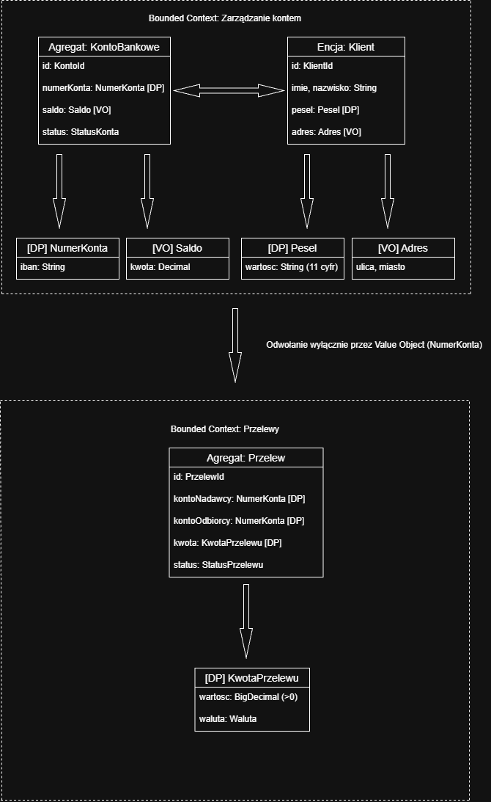

# Zadanie 1 - Modelowanie Domain-Driven Design (DDD)

## 1. Opis zadania
Celem niniejszego zadania jest zamodelowanie wybranego, bezpiecznego fragmentu systemu bankowego w oparciu o zasady Domain-Driven Design. W opracowanym rozwiązaniu wyodrębniono dwa główne konteksty ograniczone (Bounded Contexts): **Zarządzanie Kontem** oraz **Przelewy**. Nacisk położono na przeniesienie walidacji logiki biznesowej do samowalidujących się obiektów wartości (Domain Primitives), co uniemożliwia utworzenie niepoprawnego stanu aplikacji. Łącznie zamodelowano 6 spójnych elementów domenowych (agregaty, encję oraz obiekty wartości), dbając o realizację powiązań wyłącznie poprzez identyfikatory i obiekty wartości.

---

## 2. Model Graficzny

---

## 3. Zdefiniowane Konteksty, Obiekty i Przyjęte Założenia

### Tabela Założeń Domenowych i Ograniczeń Walidacyjnych

| Obiekt | Typ (DDD) | Bounded Context | Atrybuty i Formaty Danych | Założenia Walidacyjne i Ograniczenia Biznesowe |
| :--- | :--- | :--- | :--- | :--- |
| **KontoBankowe** | Agregat | Zarządzanie Kontem | • `id`: `KontoId` • `numerKonta`: `NumerKonta` • `saldo`: `Saldo` • `status`: `StatusKonta` | • Agregat zarządza spójnością i cyklem życia konta. • Modyfikacja stanu wyłącznie poprzez metody domenowe (np. `wplac()`, `zablokuj()`). • Całkowity brak setterów; saldo nie może być ujemne dla kont standardowych. |
| **Klient** | Encja | Zarządzanie Kontem | • `id`: `KlientId` • `imie`: String • `nazwisko`: String • `pesel`: `Pesel` • `adres`: `Adres` | • Obiekt z unikalną tożsamością (`KlientId`). • Imię oraz nazwisko posiadają długość od 2 do 50 znaków. • Zmiana adresu skutkuje przypisaniem nowej instancji obiektu wartości `Adres`. |
| **NumerKonta** | Domain Primitive (VO) | Zarządzanie Kontem | • `iban`: String | • Niemutowalny obiekt wartości. • Automatyczna walidacja przy tworzeniu: dokładnie 26 cyfr (dla standardu PL). • Próba utworzenia niepoprawnego IBAN natychmiast wyzwala wyjątek domenowy. |
| **Pesel** | Domain Primitive (VO) | Zarządzanie Kontem | • `wartosc`: String | • Niemutowalny obiekt wartości chroniący przed zjawiskiem *Primitive Obsession*. • Walidacja przy konstrukcji: dokładnie 11 cyfr. |
| **Adres** | Value Object | Zarządzanie Kontem | • `ulica`: String • `miasto`: String | • Niemutowalny obiekt grupujący dane adresowe. |
| **Przelew** | Agregat | Przelewy | • `id`: `PrzelewId` • `kontoNadawcy`: `NumerKonta` • `kontoOdbiorcy`: `NumerKonta` • `kwota`: `KwotaPrzelewu` • `status`: `StatusPrzelewu` • `dataZlecenia`: LocalDateTime | • Agregat realizujący proces płatności. • Odwołuje się do kont nadawcy i odbiorcy **wyłącznie** poprzez Obiekt Wartości (`NumerKonta`), unikając twardych zależności encyjnych.
| **KwotaPrzelewu** | Domain Primitive (VO) | Przelewy | • `wartosc`: BigDecimal • `waluta`: Waluta | • Wartość `BigDecimal` musi być ściśle dodatnia (> 0). • Nakłada górny limit pojedynczej transakcji (np. maks. 100 000.00 PLN). • Waluta musi odpowiadać dozwolonym kodom ISO 4217 (PLN, EUR). |

---

### Integracja Pomiędzy Obiektami i Kontekstami

1. **Inicjalizacja i realizacja płatności:**
   * Kontekst *Przelewy* nie modyfikuje bezpośrednio struktury agregatu `KontoBankowe`. Weryfikacja konta nadawcy i odbiorcy odbywa się poprzez odwołanie do niezmiennego identyfikatora w postaci Obiektu Wartości `NumerKonta`.
2. **Granice zaufania:**
   * Dane przekraczające granicę kontekstu *Zarządzanie Kontem* do kontekstu *Przelewy* są walidowane i tłumaczone na poziomie obiektów wartości (`NumerKonta`, `KwotaPrzelewu`). Uniemożliwia to przekazanie niezweryfikowanych danych wejściowych do wnętrza agregatu `Przelew`.
3. **Niemutowalność:**
   * Wszystkie Obiekty Wartości oraz Domain Primitives są niemutowalne. Każda operacja biznesowa (np. zmiana kwoty lub adresu) tworzy nową instancję obiektu, co zapobiega powstawaniu nieoczekiwanych efektów ubocznych.